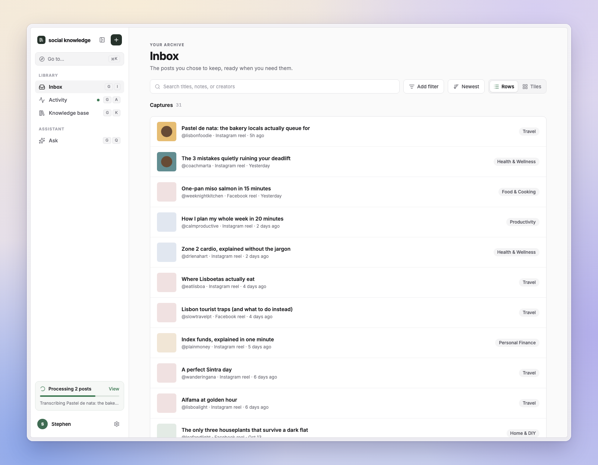
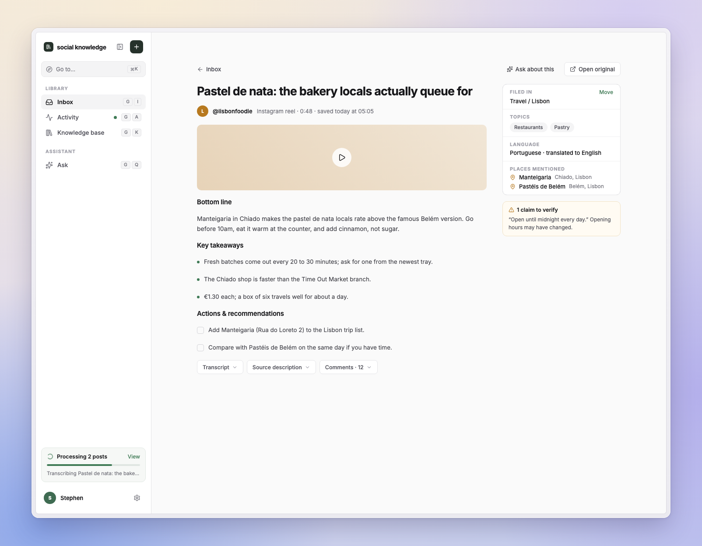
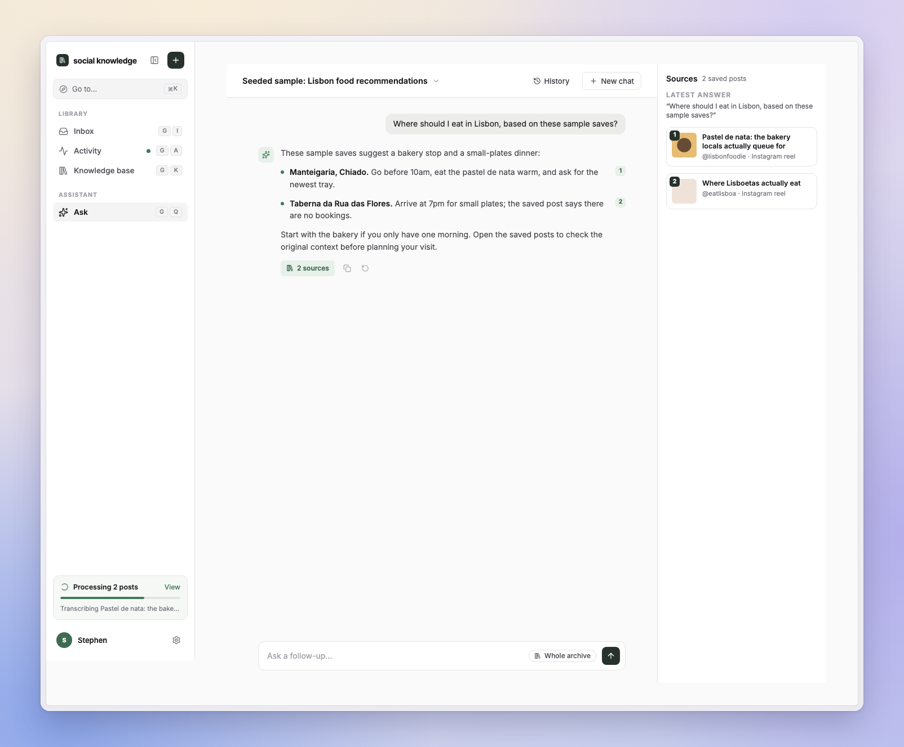

# Library and Ask

Save a supported Facebook or Instagram video from the Share Sheet or your browser. Social Knowledge keeps the media and source, extracts transcripts and takeaways, and makes your archive searchable—so you can find the recommendation, revisit the explanation, or ask a follow-up later.

*The screenshots below show the current app with synthetic demo content. The Ask response is a seeded sample, not a live model result.*

## Find the clip you meant to come back to

Search your Inbox and narrow it by platform, category, or topic. Switch between rows and tiles while keeping your filters.

## Keep the useful parts and the original source

Open a capture to review its takeaways, recommendations, and transcript alongside the saved media. Creator attribution and the original source link stay with the note, so you can check the context.

## Ask your archive, then follow the sources

Ask questions about what you have saved and continue the conversation. Cited answers link back to the saved notes so you can inspect the evidence.

## Navigate your library

The dashboard uses a desktop sidebar and mobile bottom navigation. Inbox has tile and table views, archive-wide sorting, and filters for search, platform, category, and topic. Capture opens a dialog on desktop or a mobile overlay; Activity separates failures, active processing, and completed jobs. Settings groups AI, connections, API keys, export/language, and account controls by topic. The app remembers the Inbox view on the current device.

Capture failures are stored as a stable category, friendly recovery guidance, and a separate bounded technical diagnostic. Activity keeps the diagnostic collapsed by default so normal users see what happened and what to do rather than raw downloader output.

## Follow-up questions and context

Ask AI stores each user and assistant turn with its role and uses a dedicated turn planner to resolve follow-ups. Formatting-only follow-ups reuse the prior answer's cited captures, while new subjects run archive search. When the conversation approaches `ASK_CONTEXT_BUDGET_TOKENS` (default `24000`), older turns are replaced in the model request by a persisted, untrusted checkpoint; the original transcript remains intact in SQLite. If the summarizer is temporarily unavailable, a bounded local checkpoint excerpt keeps the turn usable and is marked in retrieval diagnostics. Tune `ASK_COMPACTION_THRESHOLD` (default `0.7`) to compact earlier or later.

For provider tasks and translation preferences, see [Settings and AI](./settings.md). To take your archive elsewhere, see [portable backups](./self-hosting.md#portable-library-backups).
